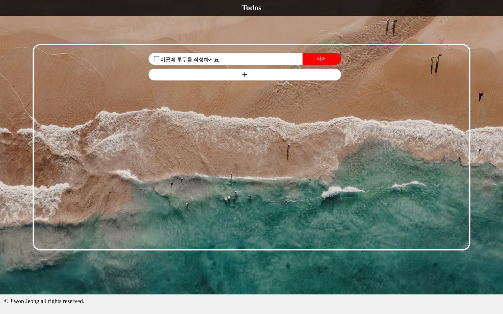

# ✅ Todo Note

**바닐라 JavaScript로 만든 할 일 메모장**

## 기능

- **+ 버튼**으로 입력창을 열어 할 일 추가 (최대 15자)
- 프레임워크 없이 DOM API만 사용

수업 예제로 만든 프로젝트이며, GitHub Actions로 GitHub Pages에 배포됩니다.

## 실행

`index.html`을 브라우저로 열면 됩니다.
